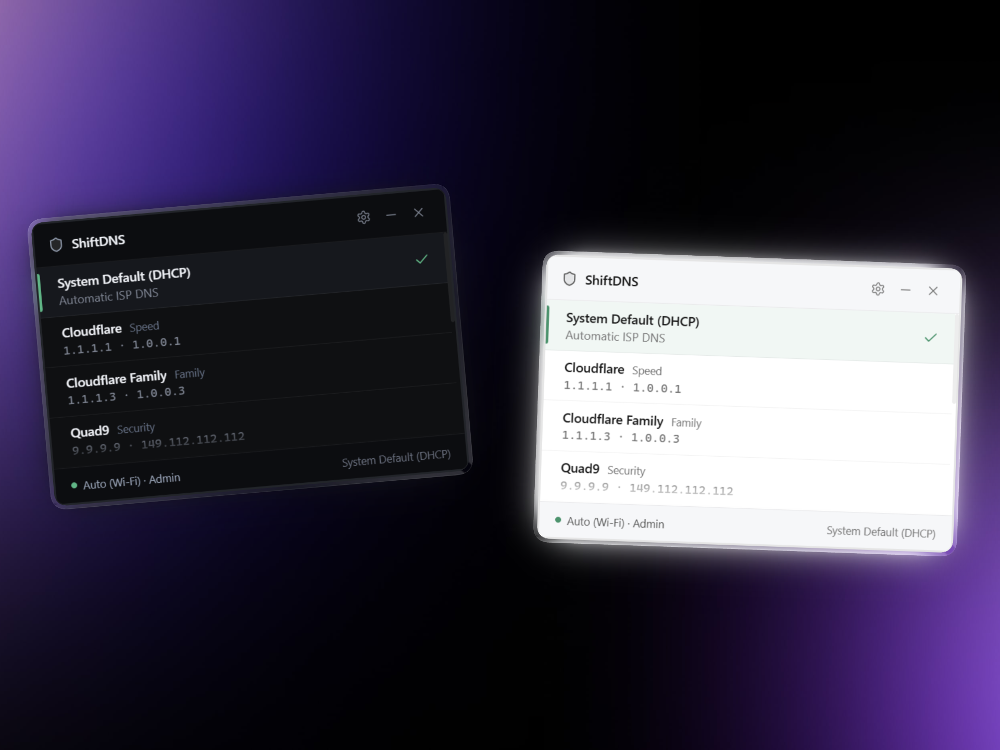

# ShiftDNS

Lightweight Windows DNS & DoH switcher built with Rust and WebView2.



## Features
- Instant DNS and DNS-over-HTTPS (DoH) switching
- Built-in latency benchmark
- System tray quick-toggle
- Custom DNS servers and dark/light themes

## Download
Download `ShiftDNS-Setup.exe` or portable `ShiftDNS.exe` from [Releases](https://github.com/NexiLune/ShiftDNS/releases).

## Build
```bash
cargo build --release
```
